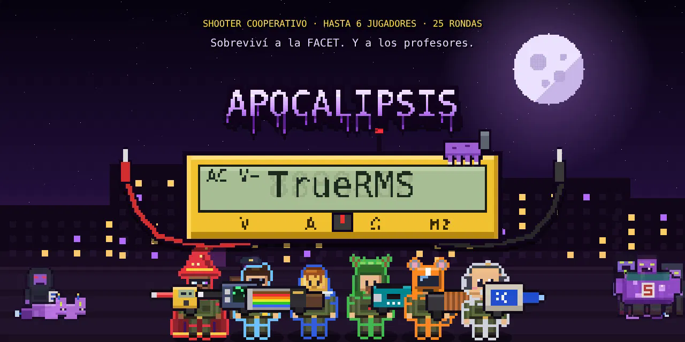

<p align="center">
  
</p>

<h1 align="center">Apocalipsis TrueRMS</h1>

<p align="center">
  Shooter cooperativo de zombies en pixel art · hasta 6 jugadores en la misma red · 25 rondas + Boss Rush + FINAL<br>
  Hecho por y para alumnos de Ingeniería en Computación — FACET · UNT
</p>

---

## La historia

Seis estudiantes llevan días encerrados en el laboratorio terminando el Proyecto Integrador. Cuando por fin salen, la facultad está llena de zombies violetas. Se arman con lo que tienen a mano (multímetros, cautines, fuentes de laboratorio) y tienen que aguantar 25 rondas con los profesores esperándolos cada 5… y después, lo que sea que esté haciendo temblar el piso.

## Cómo jugar

**Opción 1 — En el navegador (lo más fácil)**
Entrá a **https://leaders-devs.github.io/ApocalipsisTrueRMS/**, tocá **Crear sala** y pasale el **código de 4 dígitos** a tus compañeros para que entren con **Unirse a una sala**.

**Opción 2 — Instalarlo como app (PC y Android)**
Abrí el link en Chrome o Edge y tocá **Instalar juego** (en el menú principal) o el ícono de instalar de la barra de direcciones. Queda un acceso directo con el logo en el escritorio / pantalla de inicio y se abre en su propia ventana, a pantalla completa. En iPhone: Safari → Compartir → *Agregar a inicio*.

**Entrar con la partida empezada:** el código de la sala se ve arriba a la derecha. El que entra elige un personaje libre (tiene 10 s) y juega desde la ronda siguiente, con plata para ponerse a la par. Si alguien se va, su personaje queda libre con todo su progreso para el próximo que entre.

**Opción 3 — Solo**
Abrí `index.html` y elegí **Jugar solo**.

## Controles

| Tecla | Acción |
|---|---|
| `WASD` | Moverse |
| Mouse | Apuntar / disparar |
| `1` `2` `3` `4` | Melee · Arma 1 · Arma 2 · Granadas |
| `R` | Recargar |
| `E` (mantener) | Revivir compañero |
| `Q` | Súper (se carga haciendo daño; la barra está debajo de tu vida) |
| `1` `2` `3` `4` en el FINAL | Quick Time Event: todos juntos |

**En el celular:** cruceta a la izquierda para moverte, joystick a la derecha para apuntar (apuntar = disparar), botones de rodar y súper. Las armas se cambian tocando sus casillas y para revivir se mantiene tocado al compañero caído.
| `B` | Abrir / cerrar la tienda entre rondas |
| `Esc` | Pausa |

## Personajes

| | Personaje | Súper |
|---|---|---|
| 🔴 | **Ulises** — Mago de Otra Tierra | Plano de obra: una cuadrilla de obreros pelea por él… mientras se toma el colectivo a Aguilares (20 s) |
| 🔵 | **Santiago** — Presidente de la Bacho | Urna: los zombies hacen fila para votar a La Bachofen |
| 🔷 | **Facundo** — El Gran Flan | Flan gigante que atrae y explota (pierde el 60% de su vida) |
| 🟢 | **Lucas** — El Druida Tester | **Como en Villa Carmela**: bosque que cura y revive (echa raíces) |
| 🟠 | **Gabriel** — El Ratón Motorizado | **Viejos Moteros**: estampida que arrastra a los zombies hasta el borde del mapa (le cuesta puntos) |
| ⚪ | **Koro** — El Bebé Programador | Breakpoint: congela la horda (después corrige TPs) |

## Qué tiene

- **25 rondas** con hordas crecientes y eventos aleatorios (apagón, recursantes, gusanos…).
- **5 profesores jefe** en orden aleatorio cada partida, con presentación y ataques propios; cualquiera puede salir **reforzado**. Los acompañan ayudantes de cátedra.
- **Ronda bonus: Boss Rush** — los cinco profesores llegan de a uno, por tiempo: hay que bajarlos antes de que se junten.
- **Nivel FINAL** — un jefe gigante que rompe el mapa desde los bordes hasta dejar solo el patio de la fuente, y se remata con un **Quick Time Event cooperativo**.
- **Tienda entre rondas** (15 s): armas temáticas, mejoras, niveles de arma, **combinaciones** y granadas.
- **Revivir** compañeros durante la ronda o en los primeros 10 s de la siguiente.
- **Partida guardada** automática al terminar cada ronda (y exportable).
- Intro, cinemáticas de jefes y un final que no te esperás.

## Archivos

```
index.html            el juego completo (un solo archivo)
manifest.webmanifest  datos de la app instalable
sw.js                 permite instalarlo y abrirlo como app
icon-192.png          ícono
icon-512.png          ícono grande
poster.png            este póster
LICENSE               licencia (todos los derechos reservados)
OFL-Monocraft.txt     licencia de la fuente
```

## Publicarlo en GitHub Pages

1. Subí todos esos archivos a la raíz del repo `ApocalipsisTrueRMS`.
2. **Settings → Pages → Source:** `Deploy from a branch`, rama `main`, carpeta `/ (root)`.
3. Queda en **https://leaders-devs.github.io/ApocalipsisTrueRMS/**

> La conexión entre jugadores usa WebRTC (PeerJS) y necesita internet.

## Licencia

© 2026 **Leaders Devs**. Todos los derechos reservados — ver [LICENSE](LICENSE).
Fuente Monocraft © Idrees Hassan (SIL OFL 1.1). PeerJS (MIT).

---

<p align="center"><sub>Hecho por Leaders Devs. Ningún profesor fue lastimado en la realización de este juego.</sub></p>
